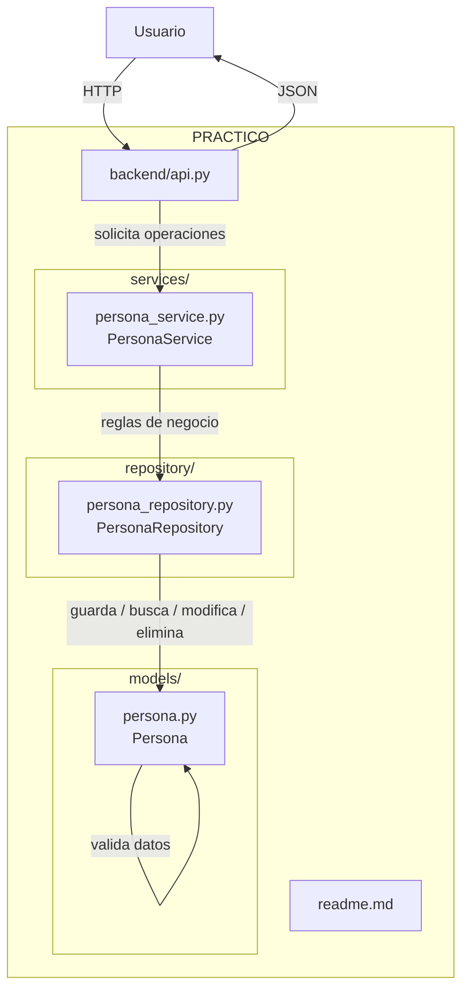

```text
PRACTICO/
├── backend/
│   ├── api.py
│   ├── models/
│   │   └── persona.py
│   ├── services/
│   │   └── persona_service.py
│   └── repository/
│       └── persona_repository.py
│
├── frontend/
│   ├── src/
│   ├── public/
│   ├── package.json
│   └── bun.lock
│
└── readme.md
```


